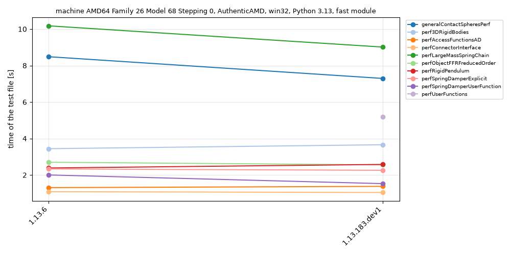
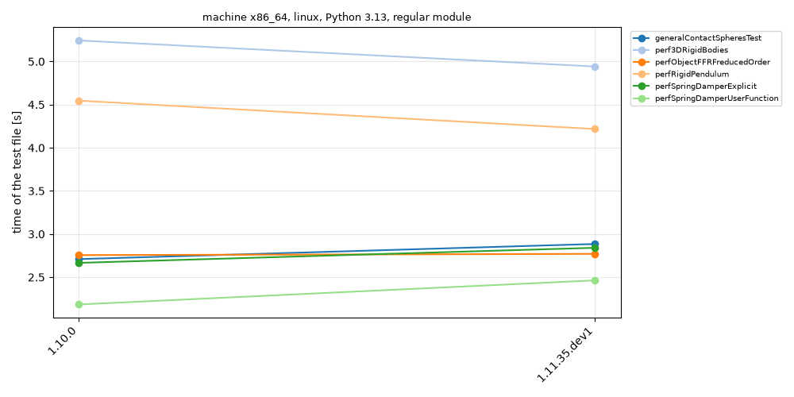

<!-- GENERATED by python/testing/performanceHistory.py from performanceHistory.json - do not edit -->
# Performance history

The performance runs added to `performanceHistory.json` (#3079), per series of machine, system, Python and
module. Times in seconds: of each test file the wall-clock time, of each single run the solver time
(solver.timer.total). A version whose CPU load before the tests was above 20 % is marked with *.

## machine AMD64 Family 26 Model 68 Stepping 0, AuthenticAMD, win32, Python 3.13, fast module

### Test files

| | 1.13.6 | 1.13.183.dev1 | 1.13.408.dev1 | 1.13.427.dev1 | 1.13.515.dev1 | 1.13.548.dev1 |
|---|---:|---:|---:|---:|---:|---:|
| generalContactSpheresPerf.py | 8.485 | 7.294 | 8.465 | 8.981 | 8.322 | 8.996 |
| perf3DRigidBodies.py | 3.443 | 3.659 | 1.839 | 1.979 | 1.935 | 1.806 |
| perfAccessFunctionsAD.py | 1.307 | 1.377 | 1.388 | 1.508 | 1.503 | 0.924 |
| perfConnectorInterface.py | 1.085 | 1.042 | 1.077 | 1.153 | 1.202 | 1.033 |
| perfLargeMassSpringChain.py | 10.177 | 9.013 | 9.218 | 10.027 | 9.813 | 9.566 |
| perfObjectFFRFreducedOrder.py | 2.699 | 2.554 | 2.392 | 2.563 | 2.506 | 2.133 |
| perfRigidPendulum.py | 2.384 | 2.579 | 2.604 | 2.670 | 2.738 | 2.650 |
| perfSpringDamperExplicit.py | 2.331 | 2.257 | 2.582 | 2.814 | 2.757 | 2.665 |
| perfSpringDamperUserFunction.py | 2.003 | 1.527 | 1.573 | 1.723 | 1.651 | 1.633 |
| perfUserFunctions.py |  | 5.183 | 5.258 | 5.578 | 5.543 | 4.106 |
| total | 33.913 | 36.484 | 36.396 | 38.995 | 37.969 | 35.511 |

### Single runs, solver time

| | 1.13.6 | 1.13.183.dev1 | 1.13.408.dev1 | 1.13.427.dev1 | 1.13.515.dev1 | 1.13.548.dev1 |
|---|---:|---:|---:|---:|---:|---:|
| generalContactSpheresPerf:nt1 | 4.886 | 3.981 | 4.307 | 4.900 | 4.374 | 4.526 |
| generalContactSpheresPerf:nt4 | 1.503 | 1.340 | 1.822 | 1.692 | 1.674 | 1.968 |
| generalContactSpheresPerf:nt8 | 0.835 | 0.783 | 1.118 | 1.073 | 0.986 | 1.198 |
| perf3DRigidBodies.py | 3.357 | 3.598 | 1.771 | 1.905 | 1.864 | 1.728 |
| perfAccessFunctionsAD:cable-n200-implicit | 0.538 | 0.555 | 0.557 | 0.615 | 0.609 | 0.079 |
| perfAccessFunctionsAD:rigid2D-n200-explicit | 0.252 | 0.292 | 0.294 | 0.310 | 0.309 | 0.295 |
| perfAccessFunctionsAD:rigid2D-n200-implicit | 0.046 | 0.053 | 0.057 | 0.056 | 0.056 | 0.053 |
| perfAccessFunctionsAD:rigidEP-n100-implicit | 0.030 | 0.029 | 0.029 | 0.031 | 0.031 | 0.029 |
| perfAccessFunctionsAD:rigidRxyz-n100-explicit | 0.338 | 0.352 | 0.353 | 0.389 | 0.393 | 0.370 |
| perfAccessFunctionsAD:rigidRxyz-n100-implicit | 0.065 | 0.061 | 0.063 | 0.070 | 0.070 | 0.061 |
| perfConnectorInterface:coordinate-n1000-explicit | 0.255 | 0.250 | 0.269 | 0.289 | 0.328 | 0.309 |
| perfConnectorInterface:gravity-n200-implicit | 0.124 | 0.117 | 0.122 | 0.123 | 0.128 | 0.119 |
| perfConnectorInterface:rigid-n100-explicit | 0.272 | 0.262 | 0.269 | 0.285 | 0.292 | 0.197 |
| perfConnectorInterface:rigid-n100-implicit | 0.029 | 0.029 | 0.029 | 0.031 | 0.031 | 0.030 |
| perfConnectorInterface:spring-n200-explicit | 0.242 | 0.227 | 0.228 | 0.248 | 0.252 | 0.211 |
| perfConnectorInterface:spring-n200-implicit | 0.110 | 0.106 | 0.108 | 0.108 | 0.115 | 0.110 |
| perfLargeMassSpringChain:rigid-n1000-explicit | 1.249 | 1.139 | 1.175 | 1.278 | 1.249 | 1.128 |
| perfLargeMassSpringChain:rigid-n1000-implicit | 0.967 | 0.897 | 0.596 | 0.641 | 0.653 | 0.570 |
| perfLargeMassSpringChain:rigid-n20000-explicit | 1.475 | 1.300 | 1.276 | 1.383 | 1.316 | 1.452 |
| perfLargeMassSpringChain:rigid-n5000-explicit | 1.231 | 1.123 | 1.168 | 1.306 | 1.288 | 1.123 |
| perfLargeMassSpringChain:rigid-n5000-implicit | 0.778 | 0.722 | 0.489 | 0.576 | 0.523 | 0.484 |
| perfObjectFFRFreducedOrder.py | 2.559 | 2.400 | 2.234 | 2.395 | 2.352 | 1.994 |
| perfRigidPendulum.py | 2.382 | 2.578 |  | 2.669 | 2.736 | 2.648 |
| perfSpringDamperExplicit.py | 1.174 | 1.131 | 1.277 | 1.406 | 1.395 | 1.331 |
| perfSpringDamperUserFunction.py | 2.001 | 1.525 | 1.572 | 1.721 | 1.649 | 1.632 |
| perfUserFunctions:cartesian-python |  | 0.487 | 0.496 | 0.534 | 0.526 | 0.503 |
| perfUserFunctions:cartesian-symbolic |  | 0.080 | 0.073 | 0.075 | 0.077 | 0.077 |
| perfUserFunctions:generic10-python |  | 0.345 | 0.355 | 0.364 | 0.369 | 0.352 |
| perfUserFunctions:generic10-symbolic |  | 0.039 | 0.049 | 0.048 | 0.048 | 0.040 |
| perfUserFunctions:generic100-python |  | 0.779 | 0.781 | 0.833 | 0.831 | 0.192 |
| perfUserFunctions:generic100-symbolic |  | 0.710 | 0.713 | 0.767 | 0.752 | 0.122 |
| perfUserFunctions:generic6-python |  | 0.333 | 0.335 | 0.349 | 0.355 | 0.335 |
| perfUserFunctions:generic6-symbolic |  | 0.029 | 0.042 | 0.041 | 0.038 | 0.035 |
| perfUserFunctions:load-python |  | 0.228 | 0.235 | 0.243 | 0.250 | 0.242 |
| perfUserFunctions:load-symbolic |  | 0.053 | 0.057 | 0.056 | 0.061 | 0.057 |
| perfUserFunctions:mass6-python |  | 0.521 | 0.532 | 0.560 | 0.563 | 0.551 |
| perfUserFunctions:mass6-symbolic |  | 0.111 | 0.082 | 0.084 | 0.079 | 0.078 |
| perfUserFunctions:ode1x6-python |  | 0.168 | 0.173 | 0.186 | 0.190 | 0.177 |
| perfUserFunctions:ode1x6-symbolic |  | 0.021 | 0.027 | 0.028 | 0.031 | 0.028 |
| perfUserFunctions:preStep-python |  | 0.052 | 0.059 | 0.066 | 0.062 | 0.059 |
| perfUserFunctions:preStep-symbolic |  | 0.038 | 0.044 | 0.048 | 0.046 | 0.045 |
| perfUserFunctions:rigid6-python |  | 0.879 | 0.884 | 0.942 | 0.925 | 0.897 |
| perfUserFunctions:rigid6-symbolic |  | 0.201 | 0.198 | 0.224 | 0.211 | 0.192 |
| perfUserFunctions:spring-python |  | 0.070 | 0.074 | 0.080 | 0.080 | 0.078 |
| perfUserFunctions:spring-symbolic |  | 0.029 | 0.039 | 0.040 | 0.041 | 0.037 |

## machine AMD64 Family 26 Model 68 Stepping 0, AuthenticAMD, win32, Python 3.13, regular module

### Test files

| | 1.9.0 | 1.10.0 | 1.11.0 | 1.12.0.dev1 | 1.13.6* | 1.13.42.dev1 | 1.13.53.dev1 | 1.13.100.dev1 | 1.13.102.dev1 | 1.13.104.dev1 | 1.13.109.dev1 | 1.13.111.dev1 | 1.13.117.dev1 | 1.13.121.dev1 | 1.13.141.dev1 | 1.13.150.dev1 | 1.13.160.dev1 | 1.13.161.dev1 | 1.13.174.dev1* | 1.13.183.dev1 | 1.13.190.dev1 | 1.13.303.dev1 | 1.13.307.dev1 | 1.13.309.dev1 | 1.13.331.dev1 | 1.13.398.dev1 | 1.13.399.dev1 | 1.13.401.dev1 | 1.13.408.dev1 | 1.13.418.dev1 | 1.13.427.dev1 | 1.13.502.dev1 | 1.13.515.dev1 | 1.13.530.dev1 | 1.13.548.dev1 |
|---|---:|---:|---:|---:|---:|---:|---:|---:|---:|---:|---:|---:|---:|---:|---:|---:|---:|---:|---:|---:|---:|---:|---:|---:|---:|---:|---:|---:|---:|---:|---:|---:|---:|---:|---:|
| generalContactSpheresPerf.py |  |  | 9.578 | 9.833 | 8.885 | 11.552 | 10.898 | 10.439 | 9.360 | 10.755 | 11.028 | 10.988 | 9.851 | 10.771 | 9.440 | 10.658 | 8.798 | 9.157 | 10.643 | 7.919 | 7.460 | 9.375 | 9.019 | 9.682 | 10.386 | 9.857 | 9.138 | 9.002 | 9.248 | 9.405 | 9.454 | 9.483 | 9.266 | 8.765 | 9.680 |
| generalContactSpheresTest.py | 3.484 | 3.503 |  |  |  |  |  |  |  |  |  |  |  |  |  |  |  |  |  |  |  |  |  |  |  |  |  |  |  |  |  |  |  |  |  |
| perf3DRigidBodies.py | 5.512 | 5.417 | 4.669 | 4.754 | 3.649 | 5.210 | 5.472 | 4.468 | 4.679 | 5.444 | 5.214 | 5.180 | 5.545 | 5.487 | 5.497 | 5.233 | 4.556 | 5.088 | 5.616 | 3.740 | 3.770 | 4.994 | 2.191 | 2.227 | 2.284 | 2.177 | 1.898 | 2.115 | 1.955 | 2.412 | 2.112 | 2.213 | 1.987 | 1.807 | 1.944 |
| perfAccessFunctionsAD.py |  |  |  |  | 1.422 | 1.895 | 1.668 | 1.993 | 1.631 | 1.970 | 1.720 | 2.180 | 2.077 | 2.224 | 2.419 | 1.816 | 1.525 | 1.601 | 1.716 | 1.498 | 1.494 | 1.506 | 1.508 | 1.531 | 1.588 | 1.709 | 1.621 | 1.588 | 1.589 | 1.526 | 1.616 | 1.055 | 1.607 | 1.099 | 1.002 |
| perfConnectorInterface.py |  |  | 2.631 | 2.654 | 1.278 | 1.891 | 2.079 | 1.748 | 1.550 | 1.594 | 2.092 | 2.073 | 1.701 | 1.883 | 1.617 | 1.347 | 1.329 | 1.387 | 1.511 | 1.286 | 1.278 | 1.280 | 1.298 | 1.313 | 1.363 | 1.502 | 1.399 |  | 1.326 | 1.326 | 1.423 | 1.365 | 1.414 | 1.404 | 1.200 |
| perfLargeMassSpringChain.py |  |  | 10.504 | 11.679 | 12.295 | 13.698 | 14.029 | 15.442 | 11.919 | 14.396 | 14.225 | 14.295 | 13.623 | 13.424 | 15.299 | 13.683 | 11.123 | 11.485 | 12.931 | 10.624 | 10.905 | 10.748 | 10.019 | 10.596 | 11.063 | 12.412 | 11.270 | 10.949 | 10.559 | 10.724 | 11.351 | 10.924 | 11.095 | 11.171 | 10.634 |
| perfObjectFFRFreducedOrder.py | 3.778 | 3.674 | 3.752 | 3.885 | 3.819 | 4.799 | 5.418 | 5.161 | 3.995 | 4.843 | 4.508 | 5.285 | 4.623 | 5.509 | 4.817 | 5.043 | 3.782 | 3.918 | 5.309 | 3.705 | 3.699 | 3.772 | 3.744 | 3.820 | 3.709 | 3.810 | 3.561 | 3.700 | 3.456 | 3.502 | 3.807 | 3.920 | 3.645 | 3.665 | 2.972 |
| perfRigidPendulum.py | 4.994 | 5.101 | 5.072 | 4.989 | 4.596 | 4.890 | 4.629 | 5.042 | 4.680 | 4.981 | 5.808 | 5.349 | 4.907 | 5.208 | 5.775 | 5.310 | 4.478 | 4.691 | 5.308 | 4.378 | 4.401 | 4.460 | 4.383 | 4.520 | 4.683 | 4.558 | 4.538 | 4.650 | 4.470 | 4.499 | 4.655 | 4.583 | 4.911 | 4.860 | 4.585 |
| perfSpringDamperExplicit.py | 3.373 | 3.382 | 4.451 | 4.264 | 4.375 | 5.563 | 5.342 | 5.368 | 5.818 | 5.884 | 5.243 | 5.630 | 5.610 | 5.781 | 5.060 | 5.069 | 4.118 | 4.532 | 4.899 | 4.275 | 4.080 | 4.218 | 4.261 | 4.299 | 4.578 | 4.878 | 4.702 | 4.521 | 4.410 | 4.391 | 4.540 | 4.385 | 4.713 | 4.844 | 4.577 |
| perfSpringDamperUserFunction.py |  | 2.997 | 3.023 | 2.903 | 2.401 | 2.730 | 2.365 | 3.214 | 2.735 | 2.662 | 2.802 | 2.488 | 2.856 | 2.390 | 2.951 | 2.507 | 2.009 | 2.137 | 2.307 | 1.976 | 1.984 | 2.397 | 1.967 | 2.015 | 2.178 | 2.228 | 2.103 | 2.051 | 1.971 | 2.022 | 2.156 | 2.454 | 2.127 | 2.133 | 2.116 |
| perfUserFunctions.py |  |  |  |  |  |  |  | 4.108 | 4.603 | 3.691 | 4.391 | 4.501 | 4.375 | 4.380 | 7.513 | 6.853 | 5.628 | 6.055 | 6.505 | 6.187 | 6.176 | 6.150 | 6.094 | 6.266 | 6.726 | 6.891 | 6.917 | 6.544 | 6.177 | 6.224 | 6.747 | 6.360 | 6.572 | 6.603 | 4.982 |
| total | 21.141 | 24.073 | 45.278 | 46.555 | 42.719 | 52.228 | 51.899 | 56.983 | 50.971 | 56.219 | 57.031 | 57.969 | 55.169 | 57.056 | 60.388 | 57.518 | 47.345 | 50.052 | 56.746 | 45.588 | 45.247 | 48.899 | 44.485 | 46.268 | 48.560 | 50.022 | 47.147 | 46.441 | 45.160 | 46.030 | 47.860 | 46.742 | 47.339 | 46.350 | 43.691 |

### Single runs, solver time

| | 1.9.0 | 1.10.0 | 1.11.0 | 1.12.0.dev1 | 1.13.6* | 1.13.42.dev1 | 1.13.53.dev1 | 1.13.100.dev1 | 1.13.102.dev1 | 1.13.104.dev1 | 1.13.109.dev1 | 1.13.111.dev1 | 1.13.117.dev1 | 1.13.121.dev1 | 1.13.141.dev1 | 1.13.150.dev1 | 1.13.160.dev1 | 1.13.161.dev1 | 1.13.174.dev1* | 1.13.183.dev1 | 1.13.190.dev1 | 1.13.303.dev1 | 1.13.307.dev1 | 1.13.309.dev1 | 1.13.331.dev1 | 1.13.398.dev1 | 1.13.399.dev1 | 1.13.401.dev1 | 1.13.408.dev1 | 1.13.418.dev1 | 1.13.427.dev1 | 1.13.502.dev1 | 1.13.515.dev1 | 1.13.530.dev1 | 1.13.548.dev1 |
|---|---:|---:|---:|---:|---:|---:|---:|---:|---:|---:|---:|---:|---:|---:|---:|---:|---:|---:|---:|---:|---:|---:|---:|---:|---:|---:|---:|---:|---:|---:|---:|---:|---:|---:|---:|
| generalContactSpheresPerf:nt1 |  |  | 4.776 | 4.878 | 5.147 | 6.258 | 5.725 | 5.719 | 5.048 | 5.868 | 6.058 | 6.218 | 5.251 | 5.820 | 4.666 | 5.896 | 4.571 | 4.623 | 5.409 | 4.347 | 4.047 | 4.672 | 4.450 | 4.943 | 5.380 | 5.276 | 4.818 | 4.613 | 4.661 | 4.686 | 4.831 | 4.779 | 4.696 | 4.618 | 4.925 |
| generalContactSpheresPerf:nt4 |  |  | 2.302 | 2.282 | 1.571 | 2.216 | 2.385 | 1.910 | 1.972 | 1.985 | 2.126 | 2.081 | 2.098 | 2.113 | 1.968 | 2.026 | 1.854 | 1.973 | 2.217 | 1.497 | 1.364 | 2.256 | 2.145 | 2.198 | 2.353 | 2.024 | 1.918 | 1.974 | 2.161 | 2.236 | 2.090 | 2.117 | 2.056 | 1.780 | 2.141 |
| generalContactSpheresPerf:nt8 |  |  | 1.257 | 1.300 | 0.902 | 1.330 | 1.310 | 1.231 | 1.077 | 1.179 | 1.247 | 1.213 | 1.234 | 1.267 | 1.161 | 1.210 | 1.053 | 1.224 | 1.374 | 0.876 | 0.850 | 1.229 | 1.221 | 1.290 | 1.285 | 1.199 | 1.086 | 1.129 | 1.169 | 1.253 | 1.225 | 1.213 | 1.224 | 1.058 | 1.317 |
| perf3DRigidBodies.py |  |  | 4.600 | 4.675 | 3.557 | 5.088 | 5.395 | 4.398 | 4.611 | 5.370 | 5.115 | 5.079 | 5.451 | 5.387 | 5.391 | 5.130 | 4.483 | 5.019 | 5.530 | 3.674 | 3.704 | 4.922 | 2.124 | 2.158 | 2.206 | 2.095 | 1.821 | 2.039 | 1.882 | 2.339 | 2.034 | 2.104 | 1.907 | 1.730 | 1.867 |
| perfAccessFunctionsAD:cable-n200-implicit |  |  |  |  | 0.554 | 0.671 | 0.636 | 0.765 | 0.586 | 0.675 | 0.603 | 0.759 | 0.710 | 0.833 | 0.882 | 0.603 | 0.580 | 0.594 | 0.658 | 0.576 | 0.568 | 0.575 | 0.586 | 0.592 | 0.606 | 0.651 | 0.621 | 0.617 | 0.619 | 0.586 | 0.627 | 0.102 | 0.617 |  | 0.097 |
| perfAccessFunctionsAD:rigid2D-n200-explicit |  |  |  |  | 0.305 | 0.576 | 0.381 | 0.590 | 0.439 | 0.435 | 0.346 | 0.575 | 0.555 | 0.506 | 0.602 | 0.584 | 0.348 | 0.366 | 0.382 | 0.338 | 0.340 | 0.344 | 0.334 | 0.345 | 0.352 | 0.372 | 0.366 | 0.358 | 0.345 | 0.342 | 0.361 | 0.351 | 0.359 | 0.365 | 0.331 |
| perfAccessFunctionsAD:rigid2D-n200-implicit |  |  | 0.163 | 0.164 | 0.054 | 0.069 | 0.067 | 0.063 | 0.060 | 0.065 | 0.060 | 0.060 | 0.069 | 0.097 | 0.103 | 0.063 | 0.060 | 0.066 | 0.075 | 0.061 | 0.060 | 0.060 | 0.059 | 0.061 | 0.062 | 0.065 | 0.064 | 0.064 | 0.060 | 0.061 | 0.065 | 0.060 | 0.064 | 0.065 | 0.058 |
| perfAccessFunctionsAD:rigidEP-n100-implicit |  |  | 0.377 | 0.379 | 0.035 | 0.055 | 0.037 | 0.036 | 0.035 | 0.043 | 0.055 | 0.055 | 0.047 | 0.055 | 0.057 | 0.035 | 0.037 | 0.046 | 0.040 | 0.035 | 0.035 | 0.034 | 0.035 | 0.035 | 0.036 | 0.061 | 0.038 | 0.040 | 0.046 | 0.037 | 0.038 | 0.035 | 0.039 | 0.037 | 0.034 |
| perfAccessFunctionsAD:rigidRxyz-n100-explicit |  |  | 0.402 | 0.398 | 0.364 | 0.389 | 0.423 | 0.419 | 0.401 | 0.591 | 0.498 | 0.572 | 0.564 | 0.570 | 0.601 | 0.418 | 0.389 | 0.413 | 0.429 | 0.382 | 0.383 | 0.386 | 0.388 | 0.391 | 0.414 | 0.427 | 0.418 | 0.399 | 0.403 | 0.393 | 0.412 | 0.383 | 0.415 | 0.409 | 0.378 |
| perfAccessFunctionsAD:rigidRxyz-n100-implicit |  |  | 0.506 | 0.521 | 0.072 | 0.088 | 0.080 | 0.077 | 0.075 | 0.114 | 0.115 | 0.111 | 0.085 | 0.111 | 0.116 | 0.074 | 0.074 | 0.078 | 0.082 | 0.072 | 0.073 | 0.071 | 0.072 | 0.073 | 0.081 | 0.084 | 0.077 | 0.075 | 0.077 | 0.072 | 0.076 | 0.080 | 0.076 | 0.075 | 0.066 |
| perfConnectorInterface:coordinate-n1000-explicit |  |  | 0.417 | 0.408 | 0.319 | 0.442 | 0.573 | 0.605 | 0.443 | 0.399 | 0.585 | 0.600 | 0.517 | 0.567 | 0.369 | 0.356 | 0.348 | 0.360 | 0.424 | 0.339 | 0.333 | 0.332 | 0.355 | 0.340 | 0.364 | 0.386 | 0.381 | 0.350 | 0.347 | 0.345 | 0.368 | 0.365 | 0.375 | 0.378 | 0.382 |
| perfConnectorInterface:gravity-n200-implicit |  |  | 0.730 | 0.728 | 0.132 | 0.210 | 0.215 | 0.156 | 0.131 | 0.142 | 0.207 | 0.209 | 0.168 | 0.200 | 0.135 | 0.139 | 0.137 | 0.134 | 0.134 | 0.126 | 0.125 | 0.130 | 0.126 | 0.125 | 0.135 | 0.138 | 0.135 | 0.132 | 0.125 | 0.126 | 0.136 | 0.133 | 0.147 | 0.138 | 0.127 |
| perfConnectorInterface:rigid-n100-explicit |  |  | 0.342 | 0.343 | 0.323 | 0.502 | 0.513 | 0.352 | 0.377 | 0.370 | 0.515 | 0.512 | 0.463 | 0.493 | 0.518 | 0.338 | 0.336 | 0.349 | 0.362 | 0.325 | 0.326 | 0.327 | 0.328 | 0.339 | 0.345 | 0.410 | 0.362 |  | 0.341 | 0.350 | 0.372 | 0.342 | 0.354 | 0.354 | 0.222 |
| perfConnectorInterface:rigid-n100-implicit |  |  | 0.377 | 0.387 | 0.035 | 0.036 | 0.054 | 0.036 | 0.059 | 0.038 | 0.055 | 0.054 | 0.053 | 0.055 | 0.037 | 0.036 | 0.036 | 0.038 | 0.043 | 0.035 | 0.035 | 0.035 | 0.035 | 0.035 | 0.038 | 0.037 | 0.038 | 0.037 | 0.039 | 0.040 | 0.038 | 0.036 | 0.037 | 0.037 | 0.034 |
| perfConnectorInterface:spring-n200-explicit |  |  | 0.320 | 0.321 | 0.280 | 0.431 | 0.435 | 0.382 | 0.290 | 0.377 | 0.441 | 0.412 | 0.290 | 0.350 | 0.296 | 0.283 | 0.281 | 0.311 | 0.324 | 0.278 | 0.276 | 0.274 | 0.270 | 0.278 | 0.288 | 0.330 | 0.291 |  | 0.287 | 0.278 | 0.311 | 0.284 | 0.301 | 0.298 | 0.243 |
| perfConnectorInterface:spring-n200-implicit |  |  | 0.399 | 0.409 | 0.134 | 0.205 | 0.207 | 0.145 | 0.183 | 0.205 | 0.204 | 0.204 | 0.136 | 0.141 | 0.200 | 0.138 | 0.138 | 0.141 | 0.149 | 0.131 | 0.129 |  |  | 0.142 | 0.136 | 0.137 | 0.134 | 0.135 | 0.134 | 0.135 | 0.141 | 0.133 | 0.142 | 0.142 | 0.133 |
| perfLargeMassSpringChain:rigid-n1000-explicit |  |  | 1.543 | 1.605 | 1.446 | 1.519 | 2.015 | 1.845 | 1.549 | 1.805 | 1.796 | 1.848 | 2.000 | 1.834 | 2.220 | 1.866 | 1.423 | 1.531 | 1.629 | 1.412 | 1.400 | 1.400 | 1.390 | 1.448 | 1.518 | 1.686 | 1.477 | 1.451 | 1.390 | 1.419 | 1.552 | 1.385 | 1.456 | 1.437 | 1.305 |
| perfLargeMassSpringChain:rigid-n1000-implicit |  |  | 1.187 | 1.268 | 1.111 | 1.262 | 1.362 | 1.450 | 1.228 | 1.470 | 1.384 | 1.172 | 1.397 | 1.150 | 1.363 | 1.303 | 1.111 | 1.201 | 1.281 | 1.098 | 1.092 | 1.088 | 0.721 | 0.729 | 0.772 | 0.823 | 0.766 | 0.739 | 0.704 | 0.726 | 0.764 | 0.704 | 0.745 | 0.753 | 0.649 |
| perfLargeMassSpringChain:rigid-n20000-explicit |  |  | 1.664 | 1.847 | 1.986 | 2.026 | 1.909 | 1.833 | 1.930 | 1.959 | 1.976 | 2.161 | 1.521 | 1.606 | 1.975 | 1.768 | 1.574 | 1.478 | 2.016 | 1.509 | 1.588 | 1.451 | 1.397 | 1.651 | 1.478 | 1.803 | 1.457 | 1.433 | 1.478 | 1.491 | 1.549 | 1.500 | 1.479 | 1.424 | 1.496 |
| perfLargeMassSpringChain:rigid-n5000-explicit |  |  | 1.527 | 1.833 | 1.633 | 2.042 | 1.640 | 2.291 | 1.458 | 2.019 | 2.006 | 2.272 | 1.644 | 1.692 | 2.297 | 2.042 | 1.450 | 1.517 | 1.886 | 1.380 | 1.508 | 1.418 | 1.381 | 1.452 | 1.578 | 1.655 | 1.486 | 1.435 | 1.367 | 1.433 | 1.481 | 1.374 | 1.444 | 1.465 | 1.270 |
| perfLargeMassSpringChain:rigid-n5000-implicit |  |  | 0.965 | 1.012 | 1.053 | 1.432 | 1.180 | 0.983 | 0.924 | 1.080 | 1.317 | 1.310 | 1.089 | 1.288 | 1.325 | 1.084 | 0.911 | 0.937 | 1.013 | 0.869 | 0.924 | 0.898 | 0.569 | 0.618 | 0.653 | 0.669 | 0.614 | 0.607 | 0.575 | 0.605 | 0.607 | 0.740 | 0.601 | 0.605 | 0.553 |
| perfObjectFFRFreducedOrder.py |  |  | 3.586 | 3.732 | 3.670 | 4.650 | 5.283 | 4.986 | 3.825 | 4.696 | 4.335 | 5.124 | 4.449 | 5.302 | 4.644 | 4.884 | 3.618 | 3.766 | 4.042 | 3.551 | 3.534 | 3.626 | 3.587 | 3.663 | 3.562 | 3.626 | 3.386 | 3.540 | 3.297 | 3.346 | 3.648 | 3.336 | 3.489 | 3.483 | 2.835 |
| perfRigidPendulum.py |  |  | 5.070 | 4.987 | 4.594 | 4.889 | 4.628 | 5.041 | 4.679 | 4.980 | 5.806 | 5.348 | 4.906 | 5.206 | 5.774 | 5.308 | 4.477 | 4.689 | 5.297 | 4.377 | 4.387 | 4.458 | 4.382 | 4.519 | 4.681 | 4.556 | 4.537 | 4.649 |  |  | 4.653 | 4.569 | 4.910 | 4.858 | 4.583 |
| perfSpringDamperExplicit.py |  |  | 2.937 | 2.808 | 2.975 | 3.551 | 3.796 | 3.730 | 3.420 | 3.741 | 3.415 | 3.459 | 3.459 | 3.493 | 3.525 | 3.195 | 2.763 | 3.022 | 3.232 | 2.804 | 2.729 | 2.792 | 2.807 | 2.857 | 3.058 | 3.234 | 3.070 | 3.003 | 2.880 | 2.895 | 3.003 | 2.844 | 3.083 | 3.128 | 2.976 |
| perfSpringDamperUserFunction.py |  |  | 3.021 | 2.901 | 2.400 | 2.729 | 2.363 | 3.212 | 2.733 | 2.649 | 2.800 | 2.486 | 2.854 | 2.388 | 2.949 | 2.505 | 2.007 | 2.136 | 2.284 | 1.974 | 1.972 | 2.395 | 1.965 | 2.013 | 2.176 | 2.227 | 2.101 | 2.049 | 1.969 | 2.020 | 2.154 | 2.433 | 2.126 | 2.131 | 2.114 |
| perfUserFunctions:cartesian-python |  |  |  |  |  |  |  | 0.235 | 0.162 | 0.199 | 0.756 | 0.689 | 0.704 | 0.710 | 0.826 | 0.748 | 0.513 | 0.542 | 0.574 | 0.519 | 0.518 | 0.529 | 0.510 | 0.541 | 0.566 | 0.590 | 0.569 | 0.554 | 0.529 | 0.526 | 0.558 | 0.546 | 0.561 | 0.558 | 0.543 |
| perfUserFunctions:cartesian-symbolic |  |  |  |  |  |  |  | 0.086 | 0.079 | 0.116 | 0.113 | 0.114 | 0.111 | 0.112 | 0.089 | 0.115 | 0.076 | 0.099 | 0.110 | 0.124 | 0.123 | 0.106 | 0.107 | 0.106 | 0.119 | 0.116 | 0.147 | 0.116 | 0.105 | 0.108 | 0.123 | 0.114 | 0.118 | 0.120 | 0.112 |
| perfUserFunctions:generic10-python |  |  |  |  |  |  |  | 0.666 | 0.925 | 0.468 | 0.498 | 0.504 | 0.530 | 0.547 | 0.524 | 0.524 | 0.376 | 0.384 | 0.401 | 0.385 | 0.385 | 0.384 | 0.380 | 0.398 | 0.431 | 0.440 | 0.482 | 0.410 | 0.386 | 0.391 | 0.428 | 0.402 | 0.421 | 0.415 | 0.386 |
| perfUserFunctions:generic10-symbolic |  |  |  |  |  |  |  | 0.099 | 0.083 | 0.081 | 0.056 | 0.071 | 0.079 | 0.076 | 0.053 | 0.078 | 0.049 | 0.054 | 0.061 | 0.079 | 0.077 | 0.082 | 0.081 | 0.084 | 0.087 | 0.092 | 0.088 | 0.089 | 0.085 | 0.085 | 0.092 | 0.082 | 0.088 | 0.090 | 0.073 |
| perfUserFunctions:generic100-python |  |  |  |  |  |  |  | 1.239 | 1.316 | 1.035 | 0.869 | 1.003 | 0.962 | 1.010 | 0.979 | 1.055 | 0.827 | 0.874 | 0.946 | 0.819 | 0.821 | 0.825 | 0.823 | 0.844 | 0.893 | 0.911 | 0.881 | 0.868 | 0.822 | 0.829 | 0.887 | 0.845 | 0.874 | 0.884 | 0.207 |
| perfUserFunctions:generic100-symbolic |  |  |  |  |  |  |  | 0.828 | 0.768 | 0.880 | 0.841 | 0.874 | 0.767 | 0.781 | 0.982 | 0.846 | 0.760 | 0.816 | 0.858 | 0.755 | 0.752 | 0.755 | 0.753 | 0.768 | 0.809 | 0.806 | 0.812 | 0.799 | 0.759 | 0.761 | 0.891 | 0.758 | 0.797 | 0.807 | 0.138 |
| perfUserFunctions:generic6-python |  |  |  |  |  |  |  | 0.513 | 0.823 | 0.480 | 0.544 | 0.529 | 0.522 | 0.502 | 0.577 | 0.360 | 0.359 | 0.378 | 0.395 | 0.373 | 0.374 | 0.368 | 0.366 | 0.378 | 0.411 | 0.413 | 0.516 | 0.401 | 0.382 | 0.374 | 0.402 | 0.394 | 0.399 | 0.398 | 0.377 |
| perfUserFunctions:generic6-symbolic |  |  |  |  |  |  |  | 0.064 | 0.064 | 0.038 | 0.059 | 0.058 | 0.058 | 0.055 | 0.063 | 0.037 | 0.036 | 0.041 | 0.041 | 0.066 | 0.064 | 0.070 | 0.072 | 0.071 | 0.074 | 0.075 | 0.088 | 0.077 | 0.073 | 0.073 | 0.079 | 0.076 | 0.076 | 0.077 | 0.068 |
| perfUserFunctions:load-python |  |  |  |  |  |  |  | 0.119 | 0.164 | 0.184 | 0.377 | 0.375 | 0.365 | 0.367 | 0.357 | 0.292 | 0.246 | 0.270 | 0.279 | 0.265 | 0.265 | 0.267 | 0.273 | 0.265 | 0.297 | 0.335 | 0.316 | 0.285 | 0.270 | 0.277 | 0.285 | 0.277 | 0.289 | 0.286 | 0.281 |
| perfUserFunctions:load-symbolic |  |  |  |  |  |  |  | 0.061 | 0.102 | 0.069 | 0.093 | 0.096 | 0.096 | 0.089 | 0.102 | 0.070 | 0.057 | 0.067 | 0.073 | 0.092 | 0.092 | 0.094 | 0.094 | 0.093 | 0.105 | 0.104 | 0.151 | 0.101 | 0.092 | 0.095 | 0.100 | 0.095 | 0.102 | 0.103 | 0.095 |
| perfUserFunctions:mass6-python |  |  |  |  |  |  |  |  |  |  |  |  |  |  | 0.845 | 0.694 | 0.577 | 0.579 | 0.709 | 0.584 | 0.586 | 0.594 | 0.582 | 0.605 | 0.658 | 0.702 | 0.623 | 0.628 | 0.592 | 0.604 | 0.635 | 0.600 | 0.631 | 0.635 | 0.601 |
| perfUserFunctions:mass6-symbolic |  |  |  |  |  |  |  |  |  |  |  |  |  |  | 0.090 | 0.088 | 0.092 | 0.146 | 0.155 | 0.173 | 0.176 | 0.136 | 0.136 | 0.134 | 0.140 | 0.186 | 0.143 | 0.140 | 0.130 | 0.134 | 0.146 | 0.125 | 0.136 | 0.143 | 0.132 |
| perfUserFunctions:ode1x6-python |  |  |  |  |  |  |  |  |  |  |  |  |  |  | 0.291 | 0.277 | 0.178 | 0.189 | 0.207 | 0.207 | 0.205 | 0.209 | 0.205 | 0.217 | 0.230 | 0.232 | 0.232 | 0.230 | 0.209 | 0.210 | 0.227 | 0.217 | 0.221 | 0.222 | 0.215 |
| perfUserFunctions:ode1x6-symbolic |  |  |  |  |  |  |  |  |  |  |  |  |  |  | 0.044 | 0.042 | 0.024 | 0.033 | 0.030 | 0.061 | 0.060 | 0.064 | 0.065 | 0.066 | 0.072 | 0.072 | 0.071 | 0.069 | 0.066 | 0.067 | 0.072 | 0.065 | 0.071 | 0.073 | 0.069 |
| perfUserFunctions:preStep-python |  |  |  |  |  |  |  |  |  |  |  |  |  |  | 0.063 | 0.072 | 0.059 | 0.067 | 0.069 | 0.122 | 0.122 | 0.125 | 0.125 | 0.126 | 0.133 | 0.138 | 0.138 | 0.134 | 0.127 | 0.129 | 0.136 | 0.136 | 0.134 | 0.137 | 0.130 |
| perfUserFunctions:preStep-symbolic |  |  |  |  |  |  |  |  |  |  |  |  |  |  | 0.045 | 0.077 | 0.043 | 0.048 | 0.046 | 0.109 | 0.107 | 0.111 | 0.111 | 0.112 | 0.123 | 0.125 | 0.121 | 0.120 | 0.114 | 0.114 | 0.126 | 0.113 | 0.121 | 0.121 | 0.116 |
| perfUserFunctions:rigid6-python |  |  |  |  |  |  |  |  |  |  |  |  |  |  | 1.053 | 1.015 | 0.978 | 1.042 | 1.068 | 0.967 | 0.972 | 0.970 | 0.952 | 0.976 | 1.066 | 1.047 | 1.037 | 1.032 | 0.976 | 0.974 | 1.058 | 0.983 | 1.033 | 1.033 | 0.980 |
| perfUserFunctions:rigid6-symbolic |  |  |  |  |  |  |  |  |  |  |  |  |  |  | 0.333 | 0.309 | 0.255 | 0.291 | 0.322 | 0.308 | 0.302 | 0.278 | 0.276 | 0.295 | 0.298 | 0.309 | 0.301 | 0.296 | 0.273 | 0.284 | 0.299 | 0.279 | 0.300 | 0.302 | 0.267 |
| perfUserFunctions:spring-python |  |  | 0.105 | 0.100 |  |  |  | 0.137 | 0.080 | 0.097 | 0.123 | 0.127 | 0.118 | 0.088 | 0.130 | 0.099 | 0.078 | 0.087 | 0.095 | 0.104 | 0.102 | 0.106 | 0.103 | 0.104 | 0.116 | 0.115 | 0.114 | 0.111 | 0.105 | 0.107 | 0.116 | 0.110 | 0.114 | 0.115 | 0.107 |
| perfUserFunctions:spring-symbolic |  |  |  |  |  |  |  | 0.056 | 0.032 | 0.038 | 0.055 | 0.053 | 0.056 | 0.035 | 0.056 | 0.045 | 0.036 | 0.038 | 0.043 | 0.067 | 0.065 | 0.068 | 0.069 | 0.070 | 0.088 | 0.075 | 0.076 | 0.074 | 0.070 | 0.071 | 0.074 | 0.072 | 0.077 | 0.077 | 0.072 |

### Solver sub-timers of 1.13.530.dev1

| run | total | ODE2RHS | massMatrix | totalJacobian | factorization | newtonIncrement | userFunctions |
|---|---:|---:|---:|---:|---:|---:|---:|
| generalContactSpheresPerf:nt1 | 4.618 | 4.537 |  |  |  | 0.015 |  |
| generalContactSpheresPerf:nt4 | 1.780 | 1.710 |  |  |  | 0.017 |  |
| generalContactSpheresPerf:nt8 | 1.058 | 0.990 |  |  |  | 0.018 |  |
| perf3DRigidBodies.py | 1.730 | 0.213 | 0.136 | 0.014 | 0.210 | 0.553 |  |
| perfAccessFunctionsAD:rigid2D-n200-explicit | 0.365 | 0.344 |  |  |  | 0.014 |  |
| perfAccessFunctionsAD:rigid2D-n200-implicit | 0.065 | 0.055 | 0.000 | 0.000 | 0.000 | 0.009 |  |
| perfAccessFunctionsAD:rigidEP-n100-implicit | 0.037 | 0.020 | 0.006 | 0.001 | 0.001 | 0.007 |  |
| perfAccessFunctionsAD:rigidRxyz-n100-explicit | 0.409 | 0.160 | 0.029 |  | 0.192 | 0.024 |  |
| perfAccessFunctionsAD:rigidRxyz-n100-implicit | 0.075 | 0.045 | 0.008 | 0.006 | 0.006 | 0.010 |  |
| perfConnectorInterface:coordinate-n1000-explicit | 0.378 | 0.337 |  |  |  | 0.029 |  |
| perfConnectorInterface:gravity-n200-implicit | 0.138 | 0.111 | 0.000 | 0.000 | 0.000 | 0.022 |  |
| perfConnectorInterface:rigid-n100-explicit | 0.354 | 0.299 |  |  |  | 0.013 |  |
| perfConnectorInterface:rigid-n100-implicit | 0.037 | 0.020 | 0.006 | 0.001 | 0.001 | 0.007 |  |
| perfConnectorInterface:spring-n200-explicit | 0.298 | 0.250 |  |  |  | 0.011 |  |
| perfConnectorInterface:spring-n200-implicit | 0.142 | 0.079 | 0.020 | 0.002 | 0.002 | 0.028 |  |
| perfLargeMassSpringChain:rigid-n1000-explicit | 1.437 | 1.099 | 0.313 |  |  | 0.009 |  |
| perfLargeMassSpringChain:rigid-n1000-implicit | 0.753 | 0.572 | 0.093 | 0.011 | 0.002 | 0.063 |  |
| perfLargeMassSpringChain:rigid-n20000-explicit | 1.424 | 1.149 | 0.253 |  |  | 0.007 |  |
| perfLargeMassSpringChain:rigid-n5000-explicit | 1.465 | 1.120 | 0.320 |  |  | 0.009 |  |
| perfLargeMassSpringChain:rigid-n5000-implicit | 0.605 | 0.418 | 0.069 | 0.053 | 0.009 | 0.048 |  |
| perfObjectFFRFreducedOrder.py | 3.483 | 1.742 | 0.366 | 1.245 | 0.011 | 0.043 |  |
| perfRigidPendulum.py | 4.858 | 0.809 | 0.002 | 0.038 | 0.011 | 0.258 |  |
| perfSpringDamperExplicit.py | 3.128 | 0.733 |  |  |  | 0.185 |  |
| perfSpringDamperUserFunction.py | 2.131 | 1.593 | 0.000 | 0.000 | 0.000 | 0.025 | 1.318 |
| perfUserFunctions:cartesian-python | 0.558 | 0.517 |  |  |  | 0.006 | 0.464 |
| perfUserFunctions:cartesian-symbolic | 0.120 | 0.084 |  |  |  | 0.006 | 0.042 |
| perfUserFunctions:generic10-python | 0.415 | 0.356 |  |  |  | 0.021 | 0.330 |
| perfUserFunctions:generic10-symbolic | 0.090 | 0.037 |  |  |  | 0.021 | 0.018 |
| perfUserFunctions:generic100-python | 0.884 | 0.100 |  |  |  | 0.767 | 0.083 |
| perfUserFunctions:generic100-symbolic | 0.807 | 0.027 |  |  |  | 0.765 | 0.012 |
| perfUserFunctions:generic6-python | 0.398 | 0.349 |  |  |  | 0.012 | 0.326 |
| perfUserFunctions:generic6-symbolic | 0.077 | 0.035 |  |  |  | 0.011 | 0.017 |
| perfUserFunctions:load-python | 0.286 | 0.245 |  |  |  | 0.006 | 0.190 |
| perfUserFunctions:load-symbolic | 0.103 | 0.066 |  |  |  | 0.006 | 0.020 |
| perfUserFunctions:mass6-python | 0.635 | 0.024 | 0.525 |  | 0.029 | 0.012 | 0.497 |
| perfUserFunctions:mass6-symbolic | 0.143 | 0.018 | 0.049 |  | 0.024 | 0.011 | 0.033 |
| perfUserFunctions:ode1x6-python | 0.222 | 0.006 |  |  |  | 0.005 | 0.157 |
| perfUserFunctions:ode1x6-symbolic | 0.073 | 0.006 |  |  |  | 0.005 | 0.012 |
| perfUserFunctions:preStep-python | 0.137 | 0.032 |  |  |  | 0.012 | 0.015 |
| perfUserFunctions:preStep-symbolic | 0.121 | 0.030 |  |  |  | 0.013 | 0.003 |
| perfUserFunctions:rigid6-python | 1.033 | 0.903 | 0.039 |  | 0.033 | 0.012 | 0.776 |
| perfUserFunctions:rigid6-symbolic | 0.302 | 0.178 | 0.039 |  | 0.032 | 0.012 | 0.069 |
| perfUserFunctions:spring-python | 0.115 | 0.078 |  |  |  | 0.006 | 0.058 |
| perfUserFunctions:spring-symbolic | 0.077 | 0.041 |  |  |  | 0.006 | 0.022 |

### Solver sub-timers of 1.13.548.dev1

| run | total | ODE2RHS | massMatrix | totalJacobian | factorization | newtonIncrement | userFunctions |
|---|---:|---:|---:|---:|---:|---:|---:|
| generalContactSpheresPerf:nt1 | 4.925 | 4.844 |  |  |  | 0.015 |  |
| generalContactSpheresPerf:nt4 | 2.141 | 2.073 |  |  |  | 0.017 |  |
| generalContactSpheresPerf:nt8 | 1.317 | 1.243 |  |  |  | 0.018 |  |
| perf3DRigidBodies.py | 1.867 | 0.211 | 0.144 | 0.017 | 0.264 | 0.639 |  |
| perfAccessFunctionsAD:cable-n200-implicit | 0.097 | 0.085 | 0.000 | 0.001 | 0.000 | 0.009 |  |
| perfAccessFunctionsAD:rigid2D-n200-explicit | 0.331 | 0.311 |  |  |  | 0.014 |  |
| perfAccessFunctionsAD:rigid2D-n200-implicit | 0.058 | 0.048 | 0.000 | 0.000 | 0.000 | 0.008 |  |
| perfAccessFunctionsAD:rigidEP-n100-implicit | 0.034 | 0.017 | 0.006 | 0.001 | 0.001 | 0.007 |  |
| perfAccessFunctionsAD:rigidRxyz-n100-explicit | 0.378 | 0.137 | 0.029 |  | 0.186 | 0.023 |  |
| perfAccessFunctionsAD:rigidRxyz-n100-implicit | 0.066 | 0.038 | 0.008 | 0.005 | 0.006 | 0.009 |  |
| perfConnectorInterface:coordinate-n1000-explicit | 0.382 | 0.343 |  |  |  | 0.027 |  |
| perfConnectorInterface:gravity-n200-implicit | 0.127 | 0.102 | 0.000 | 0.000 | 0.000 | 0.020 |  |
| perfConnectorInterface:rigid-n100-explicit | 0.222 | 0.173 |  |  |  | 0.012 |  |
| perfConnectorInterface:rigid-n100-implicit | 0.034 | 0.017 | 0.006 | 0.001 | 0.001 | 0.007 |  |
| perfConnectorInterface:spring-n200-explicit | 0.243 | 0.200 |  |  |  | 0.011 |  |
| perfConnectorInterface:spring-n200-implicit | 0.133 | 0.071 | 0.020 | 0.001 | 0.002 | 0.027 |  |
| perfLargeMassSpringChain:rigid-n1000-explicit | 1.305 | 0.955 | 0.324 |  |  | 0.009 |  |
| perfLargeMassSpringChain:rigid-n1000-implicit | 0.649 | 0.478 | 0.090 | 0.008 | 0.002 | 0.060 |  |
| perfLargeMassSpringChain:rigid-n20000-explicit | 1.496 | 1.146 | 0.327 |  |  | 0.007 |  |
| perfLargeMassSpringChain:rigid-n5000-explicit | 1.270 | 0.933 | 0.313 |  |  | 0.008 |  |
| perfLargeMassSpringChain:rigid-n5000-implicit | 0.553 | 0.377 | 0.069 | 0.041 | 0.010 | 0.048 |  |
| perfObjectFFRFreducedOrder.py | 2.835 | 1.347 | 0.304 | 1.083 | 0.012 | 0.012 |  |
| perfRigidPendulum.py | 4.583 | 0.798 | 0.002 | 0.038 | 0.011 | 0.168 |  |
| perfSpringDamperExplicit.py | 2.976 | 0.721 |  |  |  | 0.172 |  |
| perfSpringDamperUserFunction.py | 2.114 | 1.583 | 0.000 | 0.000 | 0.000 | 0.023 | 1.321 |
| perfUserFunctions:cartesian-python | 0.543 | 0.504 |  |  |  | 0.005 | 0.454 |
| perfUserFunctions:cartesian-symbolic | 0.112 | 0.078 |  |  |  | 0.005 | 0.039 |
| perfUserFunctions:generic10-python | 0.386 | 0.341 |  |  |  | 0.010 | 0.317 |
| perfUserFunctions:generic10-symbolic | 0.073 | 0.036 |  |  |  | 0.008 | 0.017 |
| perfUserFunctions:generic100-python | 0.207 | 0.094 |  |  |  | 0.097 | 0.080 |
| perfUserFunctions:generic100-symbolic | 0.138 | 0.024 |  |  |  | 0.099 | 0.012 |
| perfUserFunctions:generic6-python | 0.377 | 0.337 |  |  |  | 0.006 | 0.315 |
| perfUserFunctions:generic6-symbolic | 0.068 | 0.034 |  |  |  | 0.006 | 0.016 |
| perfUserFunctions:load-python | 0.281 | 0.243 |  |  |  | 0.005 | 0.190 |
| perfUserFunctions:load-symbolic | 0.095 | 0.060 |  |  |  | 0.005 | 0.017 |
| perfUserFunctions:mass6-python | 0.601 | 0.022 | 0.502 |  | 0.028 | 0.006 | 0.475 |
| perfUserFunctions:mass6-symbolic | 0.132 | 0.018 | 0.046 |  | 0.025 | 0.006 | 0.031 |
| perfUserFunctions:ode1x6-python | 0.215 | 0.006 |  |  |  | 0.005 | 0.153 |
| perfUserFunctions:ode1x6-symbolic | 0.069 | 0.005 |  |  |  | 0.005 | 0.012 |
| perfUserFunctions:preStep-python | 0.130 | 0.030 |  |  |  | 0.012 | 0.014 |
| perfUserFunctions:preStep-symbolic | 0.116 | 0.030 |  |  |  | 0.012 | 0.003 |
| perfUserFunctions:rigid6-python | 0.980 | 0.861 | 0.037 |  | 0.032 | 0.006 | 0.754 |
| perfUserFunctions:rigid6-symbolic | 0.267 | 0.154 | 0.036 |  | 0.031 | 0.006 | 0.064 |
| perfUserFunctions:spring-python | 0.107 | 0.073 |  |  |  | 0.005 | 0.055 |
| perfUserFunctions:spring-symbolic | 0.072 | 0.039 |  |  |  | 0.005 | 0.021 |

## machine x86_64, linux, Python 3.13, regular module

### Test files

| | 1.10.0 | 1.11.35.dev1 |
|---|---:|---:|
| generalContactSpheresTest.py | 2.710 | 2.885 |
| perf3DRigidBodies.py | 5.244 | 4.942 |
| perfObjectFFRFreducedOrder.py | 2.756 | 2.770 |
| perfRigidPendulum.py | 4.546 | 4.218 |
| perfSpringDamperExplicit.py | 2.666 | 2.841 |
| perfSpringDamperUserFunction.py | 2.184 | 2.463 |
| total | 20.105 | 20.118 |
