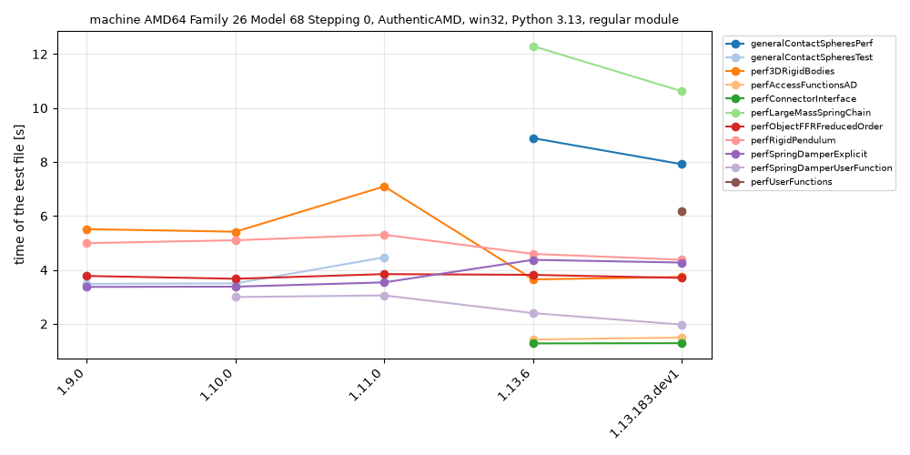

<!-- GENERATED by python/testing/performanceHistory.py from performanceHistory.json - do not edit -->
# Performance history

The performance runs added to `performanceHistory.json` (#3079), per series of machine, system, Python and
module. Times in seconds: of each test file the wall-clock time, of each single run the solver time
(solver.timer.total). A version whose CPU load before the tests was above 20 % is marked with *.

## machine AMD64 Family 26 Model 68 Stepping 0, AuthenticAMD, win32, Python 3.13, fast module

### Test files

| | 1.13.6 | 1.13.183.dev1 |
|---|---:|---:|
| generalContactSpheresPerf.py | 8.485 | 7.294 |
| perf3DRigidBodies.py | 3.443 | 3.659 |
| perfAccessFunctionsAD.py | 1.307 | 1.377 |
| perfConnectorInterface.py | 1.085 | 1.042 |
| perfLargeMassSpringChain.py | 10.177 | 9.013 |
| perfObjectFFRFreducedOrder.py | 2.699 | 2.554 |
| perfRigidPendulum.py | 2.384 | 2.579 |
| perfSpringDamperExplicit.py | 2.331 | 2.257 |
| perfSpringDamperUserFunction.py | 2.003 | 1.527 |
| perfUserFunctions.py |  | 5.183 |
| total | 33.913 | 36.484 |

### Single runs, solver time

| | 1.13.6 | 1.13.183.dev1 |
|---|---:|---:|
| generalContactSpheresPerf:nt1 | 4.886 | 3.981 |
| generalContactSpheresPerf:nt4 | 1.503 | 1.340 |
| generalContactSpheresPerf:nt8 | 0.835 | 0.783 |
| perf3DRigidBodies.py | 3.357 | 3.598 |
| perfAccessFunctionsAD:cable-n200-implicit | 0.538 | 0.555 |
| perfAccessFunctionsAD:rigid2D-n200-explicit | 0.252 | 0.292 |
| perfAccessFunctionsAD:rigid2D-n200-implicit | 0.046 | 0.053 |
| perfAccessFunctionsAD:rigidEP-n100-implicit | 0.030 | 0.029 |
| perfAccessFunctionsAD:rigidRxyz-n100-explicit | 0.338 | 0.352 |
| perfAccessFunctionsAD:rigidRxyz-n100-implicit | 0.065 | 0.061 |
| perfConnectorInterface:coordinate-n1000-explicit | 0.255 | 0.250 |
| perfConnectorInterface:gravity-n200-implicit | 0.124 | 0.117 |
| perfConnectorInterface:rigid-n100-explicit | 0.272 | 0.262 |
| perfConnectorInterface:rigid-n100-implicit | 0.029 | 0.029 |
| perfConnectorInterface:spring-n200-explicit | 0.242 | 0.227 |
| perfConnectorInterface:spring-n200-implicit | 0.110 | 0.106 |
| perfLargeMassSpringChain:rigid-n1000-explicit | 1.249 | 1.139 |
| perfLargeMassSpringChain:rigid-n1000-implicit | 0.967 | 0.897 |
| perfLargeMassSpringChain:rigid-n20000-explicit | 1.475 | 1.300 |
| perfLargeMassSpringChain:rigid-n5000-explicit | 1.231 | 1.123 |
| perfLargeMassSpringChain:rigid-n5000-implicit | 0.778 | 0.722 |
| perfObjectFFRFreducedOrder.py | 2.559 | 2.400 |
| perfRigidPendulum.py | 2.382 | 2.578 |
| perfSpringDamperExplicit.py | 1.174 | 1.131 |
| perfSpringDamperUserFunction.py | 2.001 | 1.525 |
| perfUserFunctions:cartesian-python |  | 0.487 |
| perfUserFunctions:cartesian-symbolic |  | 0.080 |
| perfUserFunctions:generic10-python |  | 0.345 |
| perfUserFunctions:generic10-symbolic |  | 0.039 |
| perfUserFunctions:generic100-python |  | 0.779 |
| perfUserFunctions:generic100-symbolic |  | 0.710 |
| perfUserFunctions:generic6-python |  | 0.333 |
| perfUserFunctions:generic6-symbolic |  | 0.029 |
| perfUserFunctions:load-python |  | 0.228 |
| perfUserFunctions:load-symbolic |  | 0.053 |
| perfUserFunctions:mass6-python |  | 0.521 |
| perfUserFunctions:mass6-symbolic |  | 0.111 |
| perfUserFunctions:ode1x6-python |  | 0.168 |
| perfUserFunctions:ode1x6-symbolic |  | 0.021 |
| perfUserFunctions:preStep-python |  | 0.052 |
| perfUserFunctions:preStep-symbolic |  | 0.038 |
| perfUserFunctions:rigid6-python |  | 0.879 |
| perfUserFunctions:rigid6-symbolic |  | 0.201 |
| perfUserFunctions:spring-python |  | 0.070 |
| perfUserFunctions:spring-symbolic |  | 0.029 |

## machine AMD64 Family 26 Model 68 Stepping 0, AuthenticAMD, win32, Python 3.13, regular module

### Test files

| | 1.9.0 | 1.10.0 | 1.11.0 | 1.13.6* | 1.13.183.dev1 |
|---|---:|---:|---:|---:|---:|
| generalContactSpheresPerf.py |  |  |  | 8.885 | 7.919 |
| generalContactSpheresTest.py | 3.484 | 3.503 | 4.468 |  |  |
| perf3DRigidBodies.py | 5.512 | 5.417 | 7.097 | 3.649 | 3.740 |
| perfAccessFunctionsAD.py |  |  |  | 1.422 | 1.498 |
| perfConnectorInterface.py |  |  |  | 1.278 | 1.286 |
| perfLargeMassSpringChain.py |  |  |  | 12.295 | 10.624 |
| perfObjectFFRFreducedOrder.py | 3.778 | 3.674 | 3.847 | 3.819 | 3.705 |
| perfRigidPendulum.py | 4.994 | 5.101 | 5.305 | 4.596 | 4.378 |
| perfSpringDamperExplicit.py | 3.373 | 3.382 | 3.539 | 4.375 | 4.275 |
| perfSpringDamperUserFunction.py |  | 2.997 | 3.057 | 2.401 | 1.976 |
| perfUserFunctions.py |  |  |  |  | 6.187 |
| total | 21.141 | 24.073 | 27.314 | 42.719 | 45.588 |

### Single runs, solver time

| | 1.9.0 | 1.10.0 | 1.11.0 | 1.13.6* | 1.13.183.dev1 |
|---|---:|---:|---:|---:|---:|
| generalContactSpheresPerf:nt1 |  |  |  | 5.147 | 4.347 |
| generalContactSpheresPerf:nt4 |  |  |  | 1.571 | 1.497 |
| generalContactSpheresPerf:nt8 |  |  |  | 0.902 | 0.876 |
| perf3DRigidBodies.py |  |  |  | 3.557 | 3.674 |
| perfAccessFunctionsAD:cable-n200-implicit |  |  |  | 0.554 | 0.576 |
| perfAccessFunctionsAD:rigid2D-n200-explicit |  |  |  | 0.305 | 0.338 |
| perfAccessFunctionsAD:rigid2D-n200-implicit |  |  |  | 0.054 | 0.061 |
| perfAccessFunctionsAD:rigidEP-n100-implicit |  |  |  | 0.035 | 0.035 |
| perfAccessFunctionsAD:rigidRxyz-n100-explicit |  |  |  | 0.364 | 0.382 |
| perfAccessFunctionsAD:rigidRxyz-n100-implicit |  |  |  | 0.072 | 0.072 |
| perfConnectorInterface:coordinate-n1000-explicit |  |  |  | 0.319 | 0.339 |
| perfConnectorInterface:gravity-n200-implicit |  |  |  | 0.132 | 0.126 |
| perfConnectorInterface:rigid-n100-explicit |  |  |  | 0.323 | 0.325 |
| perfConnectorInterface:rigid-n100-implicit |  |  |  | 0.035 | 0.035 |
| perfConnectorInterface:spring-n200-explicit |  |  |  | 0.280 | 0.278 |
| perfConnectorInterface:spring-n200-implicit |  |  |  | 0.134 | 0.131 |
| perfLargeMassSpringChain:rigid-n1000-explicit |  |  |  | 1.446 | 1.412 |
| perfLargeMassSpringChain:rigid-n1000-implicit |  |  |  | 1.111 | 1.098 |
| perfLargeMassSpringChain:rigid-n20000-explicit |  |  |  | 1.986 | 1.509 |
| perfLargeMassSpringChain:rigid-n5000-explicit |  |  |  | 1.633 | 1.380 |
| perfLargeMassSpringChain:rigid-n5000-implicit |  |  |  | 1.053 | 0.869 |
| perfObjectFFRFreducedOrder.py |  |  |  | 3.670 | 3.551 |
| perfRigidPendulum.py |  |  |  | 4.594 | 4.377 |
| perfSpringDamperExplicit.py |  |  |  | 2.975 | 2.804 |
| perfSpringDamperUserFunction.py |  |  |  | 2.400 | 1.974 |
| perfUserFunctions:cartesian-python |  |  |  |  | 0.519 |
| perfUserFunctions:cartesian-symbolic |  |  |  |  | 0.124 |
| perfUserFunctions:generic10-python |  |  |  |  | 0.385 |
| perfUserFunctions:generic10-symbolic |  |  |  |  | 0.079 |
| perfUserFunctions:generic100-python |  |  |  |  | 0.819 |
| perfUserFunctions:generic100-symbolic |  |  |  |  | 0.755 |
| perfUserFunctions:generic6-python |  |  |  |  | 0.373 |
| perfUserFunctions:generic6-symbolic |  |  |  |  | 0.066 |
| perfUserFunctions:load-python |  |  |  |  | 0.265 |
| perfUserFunctions:load-symbolic |  |  |  |  | 0.092 |
| perfUserFunctions:mass6-python |  |  |  |  | 0.584 |
| perfUserFunctions:mass6-symbolic |  |  |  |  | 0.173 |
| perfUserFunctions:ode1x6-python |  |  |  |  | 0.207 |
| perfUserFunctions:ode1x6-symbolic |  |  |  |  | 0.061 |
| perfUserFunctions:preStep-python |  |  |  |  | 0.122 |
| perfUserFunctions:preStep-symbolic |  |  |  |  | 0.109 |
| perfUserFunctions:rigid6-python |  |  |  |  | 0.967 |
| perfUserFunctions:rigid6-symbolic |  |  |  |  | 0.308 |
| perfUserFunctions:spring-python |  |  |  |  | 0.104 |
| perfUserFunctions:spring-symbolic |  |  |  |  | 0.067 |

### Solver sub-timers of 1.13.183.dev1

| run | total | ODE2RHS | massMatrix | totalJacobian | factorization | newtonIncrement | userFunctions |
|---|---:|---:|---:|---:|---:|---:|---:|
| generalContactSpheresPerf:nt1 | 4.347 | 4.271 |  |  |  | 0.014 |  |
| generalContactSpheresPerf:nt4 | 1.497 | 1.447 |  |  |  | 0.015 |  |
| generalContactSpheresPerf:nt8 | 0.876 | 0.829 |  |  |  | 0.015 |  |
| perf3DRigidBodies.py | 3.674 | 0.152 | 0.092 | 0.376 | 1.884 | 0.555 |  |
| perfAccessFunctionsAD:cable-n200-implicit | 0.576 | 0.222 | 0.001 | 0.232 | 0.091 | 0.027 |  |
| perfAccessFunctionsAD:rigid2D-n200-explicit | 0.338 | 0.319 |  |  |  | 0.013 |  |
| perfAccessFunctionsAD:rigid2D-n200-implicit | 0.061 | 0.051 | 0.000 | 0.000 | 0.000 | 0.008 |  |
| perfAccessFunctionsAD:rigidEP-n100-implicit | 0.035 | 0.019 | 0.005 | 0.001 | 0.001 | 0.007 |  |
| perfAccessFunctionsAD:rigidRxyz-n100-explicit | 0.382 | 0.153 | 0.027 |  | 0.178 | 0.021 |  |
| perfAccessFunctionsAD:rigidRxyz-n100-implicit | 0.072 | 0.042 | 0.007 | 0.007 | 0.005 | 0.009 |  |
| perfConnectorInterface:coordinate-n1000-explicit | 0.339 | 0.302 |  |  |  | 0.026 |  |
| perfConnectorInterface:gravity-n200-implicit | 0.126 | 0.102 | 0.000 | 0.000 | 0.000 | 0.020 |  |
| perfConnectorInterface:rigid-n100-explicit | 0.325 | 0.275 |  |  |  | 0.012 |  |
| perfConnectorInterface:rigid-n100-implicit | 0.035 | 0.019 | 0.006 | 0.001 | 0.001 | 0.007 |  |
| perfConnectorInterface:spring-n200-explicit | 0.278 | 0.235 |  |  |  | 0.010 |  |
| perfConnectorInterface:spring-n200-implicit | 0.131 | 0.073 | 0.018 | 0.001 | 0.002 | 0.026 |  |
| perfLargeMassSpringChain:rigid-n1000-explicit | 1.412 | 1.089 | 0.299 |  |  | 0.008 |  |
| perfLargeMassSpringChain:rigid-n1000-implicit | 1.098 | 0.822 | 0.126 | 0.013 | 0.002 | 0.119 |  |
| perfLargeMassSpringChain:rigid-n20000-explicit | 1.509 | 1.192 | 0.295 |  |  | 0.007 |  |
| perfLargeMassSpringChain:rigid-n5000-explicit | 1.380 | 1.065 | 0.292 |  |  | 0.008 |  |
| perfLargeMassSpringChain:rigid-n5000-implicit | 0.869 | 0.599 | 0.093 | 0.066 | 0.009 | 0.091 |  |
| perfObjectFFRFreducedOrder.py | 3.551 | 1.630 | 0.343 | 1.458 | 0.011 | 0.040 |  |
| perfRigidPendulum.py | 4.377 | 0.750 | 0.002 | 0.035 | 0.010 | 0.219 |  |
| perfSpringDamperExplicit.py | 2.804 | 0.694 |  |  |  | 0.180 |  |
| perfSpringDamperUserFunction.py | 1.974 | 1.476 | 0.000 | 0.000 | 0.000 | 0.023 | 1.235 |
| perfUserFunctions:cartesian-python | 0.519 | 0.482 |  |  |  | 0.006 | 0.434 |
| perfUserFunctions:cartesian-symbolic | 0.124 | 0.091 |  |  |  | 0.006 | 0.056 |
| perfUserFunctions:generic10-python | 0.385 | 0.333 |  |  |  | 0.019 | 0.310 |
| perfUserFunctions:generic10-symbolic | 0.079 | 0.033 |  |  |  | 0.018 | 0.015 |
| perfUserFunctions:generic100-python | 0.819 | 0.092 |  |  |  | 0.712 | 0.078 |
| perfUserFunctions:generic100-symbolic | 0.755 | 0.023 |  |  |  | 0.718 | 0.010 |
| perfUserFunctions:generic6-python | 0.373 | 0.329 |  |  |  | 0.011 | 0.308 |
| perfUserFunctions:generic6-symbolic | 0.066 | 0.031 |  |  |  | 0.008 | 0.014 |
| perfUserFunctions:load-python | 0.265 | 0.228 |  |  |  | 0.006 | 0.178 |
| perfUserFunctions:load-symbolic | 0.092 | 0.059 |  |  |  | 0.006 | 0.020 |
| perfUserFunctions:mass6-python | 0.584 | 0.021 | 0.485 |  | 0.027 | 0.011 | 0.460 |
| perfUserFunctions:mass6-symbolic | 0.173 | 0.016 | 0.092 |  | 0.020 | 0.009 | 0.077 |
| perfUserFunctions:ode1x6-python | 0.207 | 0.005 |  |  |  | 0.005 | 0.148 |
| perfUserFunctions:ode1x6-symbolic | 0.061 | 0.005 |  |  |  | 0.004 | 0.008 |
| perfUserFunctions:preStep-python | 0.122 | 0.028 |  |  |  | 0.012 | 0.013 |
| perfUserFunctions:preStep-symbolic | 0.109 | 0.027 |  |  |  | 0.011 | 0.002 |
| perfUserFunctions:rigid6-python | 0.967 | 0.846 | 0.037 |  | 0.031 | 0.011 | 0.727 |
| perfUserFunctions:rigid6-symbolic | 0.308 | 0.194 | 0.037 |  | 0.029 | 0.011 | 0.091 |
| perfUserFunctions:spring-python | 0.104 | 0.071 |  |  |  | 0.006 | 0.053 |
| perfUserFunctions:spring-symbolic | 0.067 | 0.035 |  |  |  | 0.006 | 0.020 |
